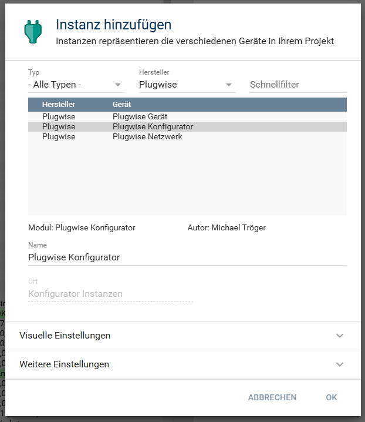
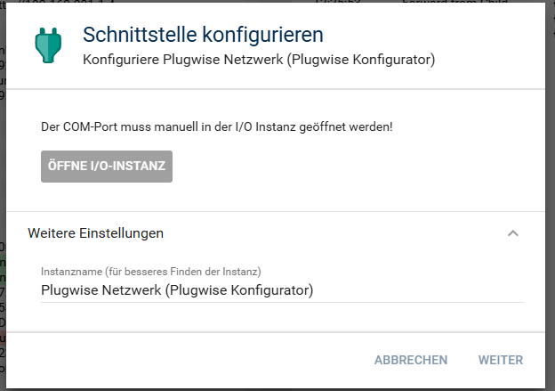
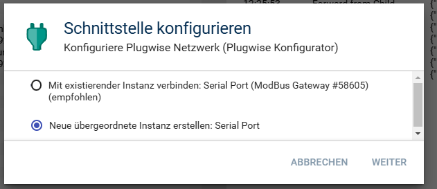
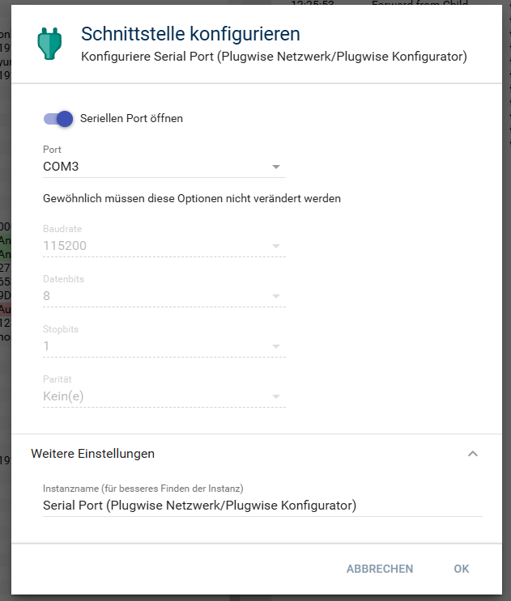
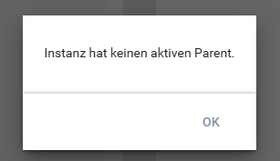
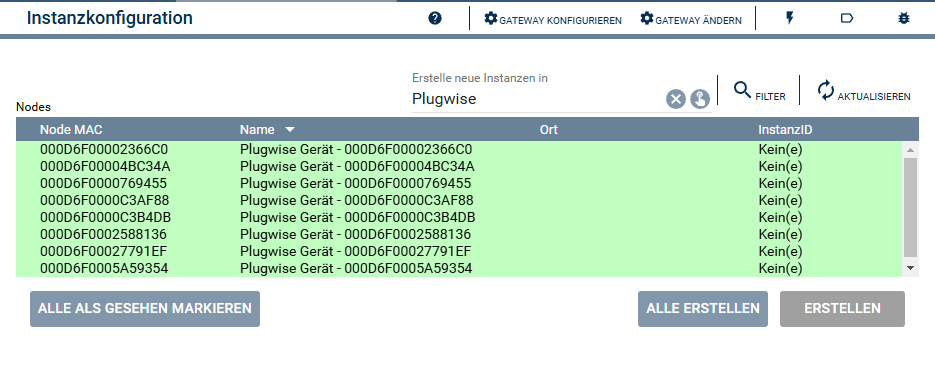

  

   

# Plugwise Konfigurator <!-- omit in toc -->

Zum anlegen von Geräte Instanzen in Symcon.

## Inhaltsverzeichnis  <!-- omit in toc -->

- [1. Funktionsumfang](#1-funktionsumfang)
- [2. Voraussetzungen](#2-voraussetzungen)
- [3. Software-Installation](#3-software-installation)
- [4. Einrichten der Instanzen in IP-Symcon](#4-einrichten-der-instanzen-in-ip-symcon)
- [5. Statusvariablen](#5-statusvariablen)
- [6. Visualisierung](#6-visualisierung)
- [7. PHP-Befehlsreferenz](#7-php-befehlsreferenz)
- [8. Aktionen](#8-aktionen)
- [9. Anhang](#9-anhang)
  - [1. Changelog](#1-changelog)
  - [2. Spenden](#2-spenden)
- [10. Lizenz](#10-lizenz)

## 1. Funktionsumfang

- Darstellen alle in Symcon und den Plugwise-Netzwerk bekannten Geräte und Instanzen.  
- Einfaches Anlagen von Instanzen in Symcon.  

## 2. Voraussetzungen

- Symcon ab Version 8.1  
- Plugwise USB-Stick inklusive Circle+  
- Weitere Plugwise-Geräte wie Circle, Stealth oder Sens  

## 3. Software-Installation

Dieses Modul ist Bestandteil der [Plugwise-Library](../README.md#3-software-installation).  

## 4. Einrichten der Instanzen in IP-Symcon

Nach der Installation über den 'Modul-Store' fragt Symcon ob eine neue Konfiguratoren Instanz erstellt werden soll.  
Bei der manuellen Einrichtung ist das Modul im Dialog `Instanz hinzufügen` unter dem Hersteller `Plugwise` zu finden.  
  

Folgender Dialog wird mit weiter bestätigt.  
Der Name der erstellten Instanz [Plugwise-Netzwerk](../PlugwiseNetwork/) kann bei bedarf angepasst werden.  
  

Es wird eine neue Instanz vom Typ [Serial Port](https://www.symcon.de/de/service/dokumentation/modulreferenz/io/serialport/) benötigt.
  

Im letzten Dialog wird jetzt der [Serial Port](https://www.symcon.de/de/service/dokumentation/modulreferenz/io/serialport/) konfiguriert.  
Hier ist der Anschluss des Plugwise USB-Stick auszuwählen.  
  

Anschließen kommt folgende Meldung, welche jedoch verschwindet, sobald Symcon das Plugwise-Netzwerk erfolgreich hochgefahren und nach Geräten durchsucht hat.  
  

Über das selektieren eines Eintrages in der Tabelle und betätigen des dazugehörigen `Erstellen` Button,  
können die Instanzen in Symcon angelegt werden.  
  

## 5. Statusvariablen

Der Konfigurator besitzt keine Statusvariablen.  

## 6. Visualisierung

Der Konfigurator besitzt keine in einer Visualisierung darstellbaren Elemente.  

## 7. PHP-Befehlsreferenz

Der Konfigurator besitzt keine Instanz-Funktionen.  

## 8. Aktionen

Der Konfigurator unterstützt keine Aktionen.  

## 9. Anhang

### 1. Changelog

[Changelog der Library](../README.md#3-changelog)

### 2. Spenden

Die Library ist für die nicht kommerzielle Nutzung kostenlos, Schenkungen als Unterstützung für den Autor werden hier akzeptiert:  

 PayPal:  
  

 Wunschliste:  
  

## 10. Lizenz

IPS-Modul:  
[CC BY-NC-SA 4.0](https://creativecommons.org/licenses/by-nc-sa/4.0/)  
