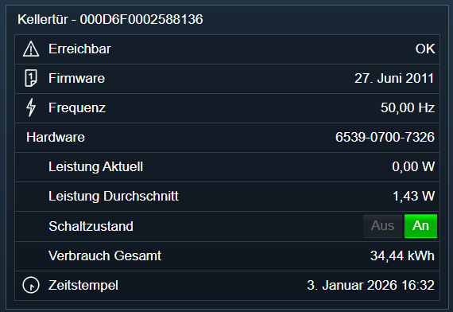

[](https://www.symcon.de/service/dokumentation/entwicklerbereich/sdk-tools/sdk-php/)
[](https://community.symcon.de/t/modul-plugwise/142771)
[](https://www.symcon.de/de/service/dokumentation/installation/migrationen/v80-v81-q3-2025/)  
[](#10-lizenz)
[](https://github.com/Nall-chan/Plugwise/actions) [](https://github.com/Nall-chan/Plugwise/actions)  
[](#2-spenden) [](#2-spenden)

# Plugwise Gerät <!-- omit in toc -->

Geräte Instanz in Symcon.

## Inhaltsverzeichnis  <!-- omit in toc -->

- [1. Funktionsumfang](#1-funktionsumfang)
- [2. Voraussetzungen](#2-voraussetzungen)
- [3. Software-Installation](#3-software-installation)
- [4. Einrichten der Instanzen in IP-Symcon](#4-einrichten-der-instanzen-in-ip-symcon)
- [5. Statusvariablen](#5-statusvariablen)
- [6. Visualisierung](#6-visualisierung)
  - [Kachel Visualisierung](#kachel-visualisierung)
  - [WebFront Visualisierung](#webfront-visualisierung)
- [7. PHP-Befehlsreferenz](#7-php-befehlsreferenz)
- [8. Aktionen](#8-aktionen)
- [9. Anhang](#9-anhang)
  - [1. Changelog](#1-changelog)
  - [2. Spenden](#2-spenden)
- [10. Lizenz](#10-lizenz)

## 1. Funktionsumfang

- Darstellen der Messwerte (Leistung, Energie, Netzfrequenz, Temperatur, Luftfeuchtigkeit) in Variablen.  
- Darstellen und ansteuern des Schaltzustandes (Circle, Circle+ und Stealth).  
- Darstellen von Bewegung (Scan) und Schalterzuständen (Switch).  
- Darstellen der Erreichbarkeit des Gerätes.  
  Antwortet das Gerät nicht, wechselt die Instanz in den Status `Node nicht erreichbar`. Eine Überwachung (z.B. Watchdog oder Ereignissteuerung) kann darauf reagieren.  

> [!NOTE]
> Getestet wurde mit Circle+ und Circle. Stealth, Scan, Sense und Switch wurden nicht mit echter Hardware getestet.

## 2. Voraussetzungen

- Symcon ab Version 8.1  
- Plugwise USB-Stick inklusive Circle+  
- Weitere Plugwise-Geräte wie Circle, Stealth, Scan, Sense oder Switch  

## 3. Software-Installation

Dieses Modul ist Bestandteil der [Plugwise-Library](../README.md#3-software-installation).  

## 4. Einrichten der Instanzen in IP-Symcon

Eine einfache Einrichtung ist über den [Plugwise Konfigurator](../PlugwiseConfigurator/) möglich.  
Bei der manuellen Einrichtung ist die Instanz im Dialog `Instanz hinzufügen` unter dem Hersteller `Plugwise` zu finden.  
  

**Konfigurationsseite:**  

  

| Eigenschaft                      | Name            |   Typ   | Standardwert | Beschreibung                                                                                    |
| :------------------------------- | :-------------- | :-----: | :----------- | :---------------------------------------------------------------------------------------------- |
| Geräte MAC                       | NodeMAC         | string  |              | MAC Adresse des Gerätes (16 Hexadezimal-Zeichen). Ist das Feld leer (z.B. bei einer per Skript angelegten Instanz), führt die Instanz keine Abfragen aus.                                                |
| Aktualisierungsintervall         | Interval        | integer | 5            | Intervall in Sekunden, in dem das Gerät abgefragt wird. `0` schaltet die zyklische Abfrage aus. |
| Zeige Schaltzustand              | showState       | boolean | true         | Statusvariable für den Schaltzustand anlegen.                                                   |
| Zeige aktuelle Leistung          | showCurrent     | boolean | true         | Statusvariable für die aktuelle Leistung anlegen.                                               |
| Zeige durchschnittliche Leistung | showAverage     | boolean | true         | Statusvariable für die durchschnittliche Leistung anlegen.                                      |
| Zeige Gesamtverbrauch            | showOverall     | boolean | true         | Statusvariable für den Verbrauch anlegen.                                                       |
| Zeige Einspeisung Gesamt         | showFeedIn      | boolean | false        | Statusvariable für die Einspeisung anlegen (für Geräte, die zurückspeisen, z.B. Wechselrichter). |
| Zeige Frequenz                   | showFrequenz    | boolean | true         | Statusvariable für die Frequenz anlegen.                                                        |
| Zeige Temperatur                 | showTemperature | boolean | true         | Statusvariable für Temperatur anlegen.                                                          |
| Zeige Luftfeuchtigkeit           | showHumidity    | boolean | true         | Statusvariable für Luftfeuchtigkeit anlegen.                                                    |
| Zeige Zeitstempel                | showTime        | boolean | true         | Statusvariable für die letzte Uhrzeit von dem Gerät anlegen.                                    |
| Zeige Firmware                   | showFirmware    | boolean | true         | Statusvariable für Firmware anlegen.                                                            |
| Zeige Hardware Version           | showHardware    | boolean | true         | Statusvariable für Hardware anlegen.                                                            |

> [!WARNING]
> Das Abwählen einer Option löscht die zugehörige Statusvariable.

Beispiel, um das Intervall zu ändern und anzuwenden:  

```php
IPS_SetProperty(12345, 'Interval', 10);
IPS_ApplyChanges(12345);
```

Batteriebetriebene Geräte (Scan, Sense, Switch) antworten nur, wenn sie wach sind. Abfragen werden deshalb nicht immer beantwortet.  

## 5. Statusvariablen

Folgende Statusvariablen werden, je nach Gerätetyp, automatisch angelegt.  

| Name                   |   Typ   | Ident              | Beschreibung                                                                         |
| :--------------------- | :-----: | :----------------- | :----------------------------------------------------------------------------------- |
| Erreichbar             | boolean | Reachable          | `OK`, solange das Gerät antwortet, sonst `Alarm`                                     |
| Schaltzustand          | boolean | State              | Schaltzustand des Gerätes, kann geschaltet werden (Circle, Circle+, Stealth)         |
| Frequenz               |  float  | Frequenz           | Netzfrequenz in Hz (Circle, Circle+, Stealth)                                        |
| Zeitstempel            | integer | Timestamp          | Letzte von dem Gerät empfangene Uhrzeit (Circle, Circle+, Stealth)                   |
| Leistung Aktuell       |  float  | PowerCurrent       | Leistung in Watt, ermittelt aus der letzten Sekunde (Circle, Circle+, Stealth)       |
| Leistung Durchschnitt  |  float  | PowerAverage       | Leistung in Watt, gemittelt über die letzten 8 Sekunden (Circle, Circle+, Stealth)   |
| Verbrauch Gesamt       |  float  | ConsumptionOverall | Energiezähler des Gerätes in kWh seit dem letzten Einschalten, nach einem Stromausfall beginnt er bei 0 (Circle, Circle+, Stealth) |
| Einspeisung Gesamt     |  float  | FeedInOverall      | Zurückgespeiste Energie in kWh (Zähler des Gerätes seit dem letzten Einschalten), positiv dargestellt. Nur wenn `Zeige Einspeisung Gesamt` aktiv ist |
| Hardware               | string  | Hardware           | Kennung der Hardware                                                                 |
| Firmware               | integer | Firmware           | Datum der Firmware                                                                   |
| Temperatur             |  float  | Temperature        | Temperatur in °C (nur Sense)                                                         |
| Luftfeuchtigkeit       |  float  | Humidity           | Luftfeuchtigkeit in % (nur Sense)                                                    |
| Bewegung               | boolean | Motion             | Bewegung erkannt (nur Scan), wird beim ersten Ereignis angelegt                      |
| Schalter 1            | boolean | Switch1            | Zustand der Schaltgruppe 1 (nur Switch), wird beim ersten Ereignis angelegt          |
| Schalter 2            | boolean | Switch2            | Zustand der Schaltgruppe 2 (nur Switch), wird beim ersten Ereignis angelegt          |

Die Zuordnung der Schaltgruppen zu den Tasten des Switch ist nicht belegt.  

> [!NOTE]
> Speist ein Gerät zurück (z.B. ein Wechselrichter), wird die Leistung negativ. Mit einem Hoymiles-Wechselrichter geprüft: der Circle zeigte -106,1 W, der Wechselrichter 104,9 W. In knapp 10 Minuten stieg `Einspeisung Gesamt` um 12 Wh, der Tagesertrag des Wechselrichters um 10 Wh (Auflösung 1 Wh). Die eingespeiste Energie zählt das Gerät in einem zweiten Zähler. Er wird in der Variable `Einspeisung Gesamt` angezeigt, wenn die Option `Zeige Einspeisung Gesamt` aktiv ist.

## 6. Visualisierung

Die direkte Darstellung in der Visualisierung ist möglich, es wird aber empfohlen mit Links zu arbeiten.  

### Kachel Visualisierung

Darstellung als Liste:  
  

### WebFront Visualisierung

  

## 7. PHP-Befehlsreferenz

Für alle Befehle gilt:  
Tritt ein Fehler auf, schlägt der Aufruf mit einer Fehlermeldung fehl (z.B. `Zeitüberschreitung` oder `Node nicht erreichbar`).  
Dies gilt auch wenn ein übergebender Wert für einen Parameter nicht gültig ist, oder außerhalb seines zulässigen Bereiches liegt.  
Der Parameter `$InstanzID` ist die Objekt-ID der Geräte-Instanz.  

```php
boolean PLUGWISE_SwitchMode(integer $InstanzID, boolean $Value);
```

Schaltet einen Circle, Circle+ oder Stealth ein (`true`) oder aus (`false`).  
Die Option `Zeige Schaltzustand` muss aktiviert sein.  
Gibt `true` zurück, wenn das Gerät den Befehl bestätigt hat.  

Beispiel:  

```php
PLUGWISE_SwitchMode(12345, true);
```

---

```php
boolean PLUGWISE_RequestState(integer $InstanzID);
```

Fragt Typ, Schaltzustand, Frequenz, Zeitstempel, Hardware und Firmware des Gerätes ab.  
Gibt `true` zurück, wenn das Gerät geantwortet hat.  

Beispiel:  

```php
PLUGWISE_RequestState(12345);
```

---

```php
boolean PLUGWISE_RequestCalibration(integer $InstanzID);
```

Fragt die Kalibrierwerte von dem Gerät ab, die zur Berechnung von Leistung und Energie nötig sind.  
Das Modul fragt sie automatisch ab, wenn sie fehlen.  
Gibt `true` zurück, wenn das Gerät geantwortet hat.  

Beispiel:  

```php
PLUGWISE_RequestCalibration(12345);
```

---

```php
boolean PLUGWISE_RequestEnergy(integer $InstanzID);
```

Fragt die Energiemessung von dem Gerät ab und aktualisiert die Variablen für Leistung und Verbrauch.  
Gibt `true` zurück, wenn das Gerät geantwortet hat.  

Beispiel:  

```php
PLUGWISE_RequestEnergy(12345);
```

## 8. Aktionen

**Grundsätzlich können alle bedienbaren Statusvariablen als Ziel einer [`Aktion`](https://www.symcon.de/service/dokumentation/konzepte/automationen/ablaufplaene/aktionen/) mit `Auf Wert schalten` angesteuert werden, so dass hier keine speziellen Aktionen benutzt werden müssen.**

Es werden keine Instanz spezifischen Aktionen angeboten.  

## 9. Anhang

### 1. Changelog

[Changelog der Library](../README.md#2-changelog)

### 2. Spenden

Die Library ist für die nicht kommerzielle Nutzung kostenlos, Schenkungen als Unterstützung für den Autor werden hier akzeptiert:  

 PayPal:  
[](https://paypal.me/Nall4chan)  

 Wunschliste:  
[](https://www.amazon.de/hz/wishlist/ls/YU4AI9AQT9F?ref_=wl_share)  

## 10. Lizenz

IPS-Modul:  
[Custom NC-SA](../LICENSE)  
