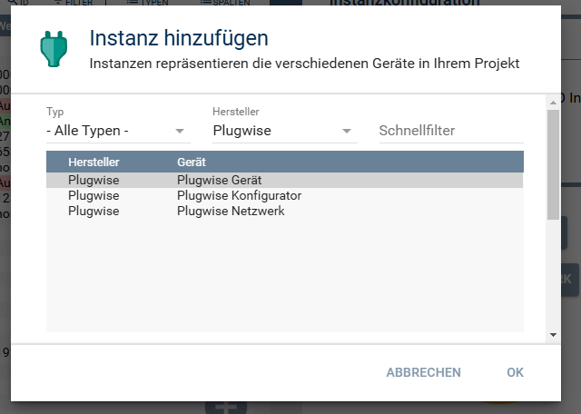
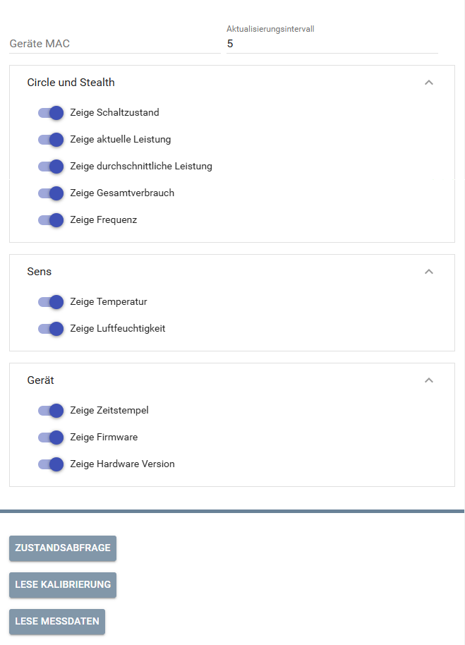
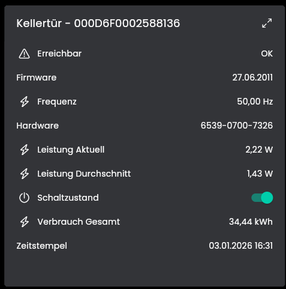

[](https://www.symcon.de/service/dokumentation/entwicklerbereich/sdk-tools/sdk-php/)
[](https://community.symcon.de/t/modul-plugwise/142771)
[](https://www.symcon.de/de/service/dokumentation/installation/migrationen/v80-v81-q3-2025/)  
[](https://creativecommons.org/licenses/by-nc-sa/4.0/)
[](https://github.com/Nall-chan/SqueezeBox/actions) [](https://github.com/Nall-chan/SqueezeBox/actions)  
[](#2-spenden)[](#2-spenden)

# Plugwise Gerät <!-- omit in toc -->

Geräte Instanz in Symcon.

## Inhaltsverzeichnis  <!-- omit in toc -->

- [1. Funktionsumfang](#1-funktionsumfang)
- [2. Voraussetzungen](#2-voraussetzungen)
- [3. Software-Installation](#3-software-installation)
- [4. Einrichten der Instanzen in IP-Symcon](#4-einrichten-der-instanzen-in-ip-symcon)
- [5. Statusvariablen](#5-statusvariablen)
- [6. Visualisierung](#6-visualisierung)
  - [Kachel Visualisierung](#kachel-visualisierung)
  - [WebFront Visualisierung](#webfront-visualisierung)
- [7. PHP-Befehlsreferenz](#7-php-befehlsreferenz)
- [8. Aktionen](#8-aktionen)
- [9. Anhang](#9-anhang)
  - [1. Changelog](#1-changelog)
  - [2. Spenden](#2-spenden)
- [10. Lizenz](#10-lizenz)

## 1. Funktionsumfang

- Darstellen der Messwerte in Variablen.  
- Darstellen und ansteuern des Schaltzustandes.  

## 2. Voraussetzungen

- Symcon ab Version 8.1  
- Plugwise USB-Stick inklusive Circle+  
- Weitere Plugwise-Geräte wie Circle, Stealth oder Sens  

## 3. Software-Installation

Dieses Modul ist Bestandteil der [Plugwise-Library](../README.md#3-software-installation).  

## 4. Einrichten der Instanzen in IP-Symcon

Eine einfache Einrichtung ist über den [Plugwise Konfigurator](../PlugwiseConfigurator/) möglich.  
Bei der manuellen Einrichtung ist die Instanz im Dialog `Instanz hinzufügen` unter dem Hersteller `Plugwise` zu finden.  
  

**Konfigurationsseite:**  

  

| Name                             | Eigenschaft     |   Typ   | Standardwert | Funktion                                                          |
| :------------------------------- | :-------------- | :-----: | :----------- | :---------------------------------------------------------------- |
| Geräte MAC                       | NodeMAC         | string  |              | MAC Adresse des Gerätes                                           |
| Aktualisierungsintervall         | Interval        | integer | 5            | Intervall in Sekunden in welchem das Gerät abgefragt werden soll. |
| Zeige Schaltzustand              | showState       | boolean | true         | Statusvariable für den Schaltzustand anlegen.                     |
| Zeige aktuelle Leistung          | showCurrent     | boolean | true         | Statusvariable für die aktuelle Leistung anlegen.                 |
| Zeige durchschnittliche Leistung | showAverage     | boolean | true         | Statusvariable für die durchschnittliche Leistung anlegen.        |
| Zeige Gesamtverbrauch            | showOverall     | boolean | true         | Statusvariable für den Gesamtverbrauch anlegen.                   |
| Zeige Frequenz                   | showFrequenz    | boolean | true         | Statusvariable für die Frequenz anlegen.                          |
| Zeige Temperatur                 | showTemperature | boolean | true         | Statusvariable für Temperatur anlegen.                            |
| Zeige Luftfeuchtigkeit           | showHumidity    | boolean | true         | Statusvariable für Luftfeuchtigkeit anlegen.                      |
| Zeige Zeitstempel                | showTime        | boolean | true         | Statusvariable für letzte Uhrzeit von dem Gerät anlegen.          |
| Zeige Firmware                   | showFirmware    | boolean | true         | Statusvariable für Firmware anlegen.                              |
| Zeige Hardware Version           | showHardware    | boolean | true         | Statusvariable für Hardware anlegen.                              |

Das abwählen einer Statusvariable führt zum löschen derselbigen.  

## 5. Statusvariablen

Folgende Statusvariablen werden, je nach Gerätetyp, automatisch angelegt.  

| Name                  |   Typ   | Ident              | Beschreibung                            |
| :-------------------- | :-----: | :----------------- | :-------------------------------------- |
| Erreichbar            | boolean | Reachable          | Wiedergabemodus                         |
| Status                | boolean | State              | Player                                  |
| Frequenz              |  float  | Frequenz           | Wiedergabemodus                         |
| Zeitstempel           |  float  | Timestamp          | letzte empfangene Uhrzeit von dem Gerät |
| Leistung Aktuell      |  float  | PowerCurrent       | Aktuell ermittelte Leistung             |
| Leistung Durchschnitt |  float  | PowerAverage       | Durchschnitt der letzten 8 Messungen    |
| Verbrauch Gesamt      |  float  | ConsumptionOverall | Gesamter Verbrauch                      |
| Hardware              | string  | Hardware           | Kennung der Hardware                    |
| Firmware              | integer | Firmware           | Datum der Firmware                      |
| Temperatur            |  float  | Temperature        | Temperatur (nur bei Sens)               |
| Luftfeuchtigkeit      |  float  | Humidity           | Luftfeuchtigkeit (nur bei Sens)         |

## 6. Visualisierung

Die direkte Darstellung in der Visualisierung ist möglich, es wird aber empfohlen mit Links zu arbeiten.  

### Kachel Visualisierung

Darstellung als Liste:  
  

### WebFront Visualisierung

  

## 7. PHP-Befehlsreferenz

Für alle Befehle gilt:  
Tritt ein Fehler auf, wird eine Warnung erzeugt.  
Dies gilt auch wenn ein übergebender Wert für einen Parameter nicht gültig ist, oder außerhalb seines zulässigen Bereiches liegt.  

```php
bool PLUGWISE_SwitchMode(int $InstanzID, bool $Value)
```

Schaltet einen Circle oder Stealth ein oder aus.  

---

```php
bool PLUGWISE_RequestState(int $InstanzID)
```

Fragt das Gerät ab.  

---

```php
bool PLUGWISE_RequestCalibration(int $InstanzID)
```

Fragt die Kalibrierung von dem Gerät ab.

---

```php
bool PLUGWISE_RequestEnergy(int $InstanzID)
```

Fragt die Energiemessung von dem Gerät ab.  

## 8. Aktionen

**Grundsätzlich können alle bedienbaren Statusvariablen als Ziel einer [`Aktion`](https://www.symcon.de/service/dokumentation/konzepte/automationen/ablaufplaene/aktionen/) mit `Auf Wert schalten` angesteuert werden, so das hier keine speziellen Aktionen benutzt werden müssen.**

Es werden keine Instanz spezifischen Aktionen angeboten.  

## 9. Anhang

### 1. Changelog

[Changelog der Library](../README.md#3-changelog)

### 2. Spenden

Die Library ist für die nicht kommerzielle Nutzung kostenlos, Schenkungen als Unterstützung für den Autor werden hier akzeptiert:  

 PayPal:  
[](https://paypal.me/Nall4chan)  

 Wunschliste:  
[](https://www.amazon.de/hz/wishlist/ls/YU4AI9AQT9F?ref_=wl_share)  

## 10. Lizenz

IPS-Modul:  
[CC BY-NC-SA 4.0](https://creativecommons.org/licenses/by-nc-sa/4.0/)  
