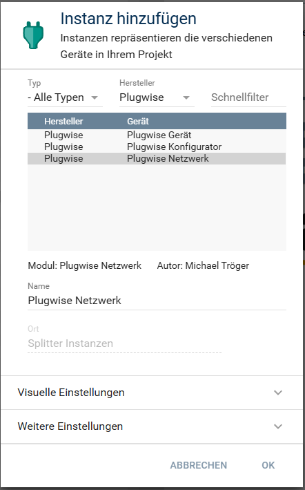
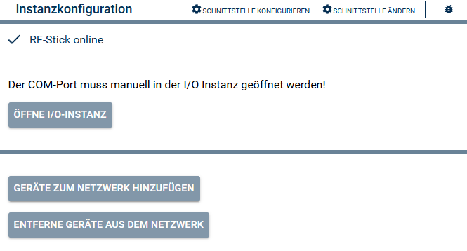
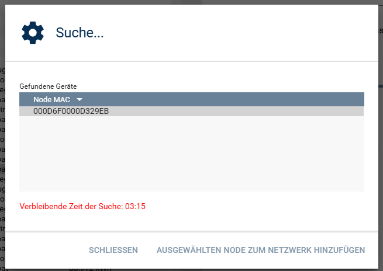
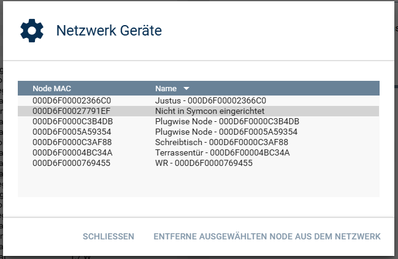

[](https://www.symcon.de/service/dokumentation/entwicklerbereich/sdk-tools/sdk-php/)
[](https://community.symcon.de/t/modul-plugwise/142771)
[](https://www.symcon.de/de/service/dokumentation/installation/migrationen/v80-v81-q3-2025/)  
[](#10-lizenz)
[](https://github.com/Nall-chan/Plugwise/actions) [](https://github.com/Nall-chan/Plugwise/actions)  
[](#2-spenden) [](#2-spenden)

# Plugwise Netzwerk (Splitter) <!-- omit in toc -->

Splitter Instanz in Symcon.

## Inhaltsverzeichnis  <!-- omit in toc -->

- [1. Funktionsumfang](#1-funktionsumfang)
- [2. Voraussetzungen](#2-voraussetzungen)
- [3. Software-Installation](#3-software-installation)
- [4. Einrichten der Instanzen in IP-Symcon](#4-einrichten-der-instanzen-in-ip-symcon)
- [5. Statusvariablen](#5-statusvariablen)
- [6. Visualisierung](#6-visualisierung)
- [7. PHP-Befehlsreferenz](#7-php-befehlsreferenz)
- [8. Aktionen](#8-aktionen)
- [9. Anhang](#9-anhang)
  - [1. Changelog](#1-changelog)
  - [2. Spenden](#2-spenden)
- [10. Lizenz](#10-lizenz)

## 1. Funktionsumfang

- Kommunikation mit dem USB-Stick.  
- An- und ab lernen von Geräten im Plugwise-Netzwerk.  

## 2. Voraussetzungen

- Symcon ab Version 8.1  
- Plugwise USB-Stick inklusive Circle+  
- Weitere Plugwise-Geräte wie Circle, Stealth oder Sens  

## 3. Software-Installation

Dieses Modul ist Bestandteil der [Plugwise-Library](../README.md#3-software-installation).  

## 4. Einrichten der Instanzen in IP-Symcon

Eine einfache Einrichtung ist durch das anlegen eines [Plugwise Konfigurator](../PlugwiseConfigurator/) möglich.  
Bei der manuellen Einrichtung ist die Instanz im Dialog `Instanz hinzufügen` unter dem Hersteller `Plugwise` zu finden.  
  

**Konfigurationsseite:**  

  

Der Splitter hat keine einstellbaren Parameter.  

Über die Schaltflächen im Aktionsbereich können neue Geräte zum Netzwerk hinzugefügt, oder auch vorhandene Geräte aus dem Netzwerk entfernt werden.

**Neue Geräte in das Netzwerk aufnehmen:**  
  

**Vorhandene Geräte aus dem Netzwerk entfernen:**  
  

**Gerät in den Werkszustand zurücksetzen und neu anlernen:**  

1. Das Gerät mit `Vorhandene Geräte aus dem Netzwerk entfernen` aus dem Netzwerk entfernen (oder mit dem Befehl [`PLUGWISE_RequestExcludeOfNode`](#7-php-befehlsreferenz)). Dabei wird es automatisch auf die Werkseinstellungen zurückgesetzt.  
2. Anschließend `Geräte zum Netzwerk hinzufügen` öffnen. Der Beitritt ist dann 4 Minuten erlaubt. Ein Gerät im Werkszustand, das mit Strom versorgt wird, meldet sich selbständig und erscheint in der Liste `Gefundene Geräte`.  
3. Das Gerät in der Liste auswählen und mit `Ausgewählten Node zum Netzwerk hinzufügen` anlernen.  

> [!NOTE]
> Ist das Gerät nicht erreichbar (z.B. weil es in einem anderen Netzwerk angelernt ist oder keine Verbindung mehr zum Circle+ hat), kann es nicht über das Netzwerk zurückgesetzt werden. Dann ist ein Reset am Gerät selbst nötig.

**Reset am Gerät (mit einem Circle geprüft):**  

1. Das Gerät 2 Sekunden einstecken, dann 2 Sekunden ausstecken.  
2. Das Gerät noch einmal 2 Sekunden einstecken und 2 Sekunden ausstecken.  
3. Das Gerät 8 Sekunden einstecken und 8 Sekunden ausstecken.  
4. Das Gerät wieder einstecken. Es ist jetzt im Werkszustand und kann wie oben beschrieben neu angelernt werden.  

Bei anderen Modellen oder Firmwareständen kann das Verfahren abweichen, dann gilt die Anleitung des Herstellers.  

## 5. Statusvariablen

Folgende Statusvariablen werden automatisch angelegt:  

| Name              |   Typ   | Ident         | Beschreibung                                            |
| :---------------- | :-----: | :------------ | :------------------------------------------------------ |
| Netzwerk ID       | string  | NetworkID     | PAN (Personal Area Netzwerk) ID                         |
| Circle+ Zeit okay | boolean | TimeSync      | Wenn die Uhr des Circle+ stimmt. Sie wird alle 10 Minuten geprüft und bei Abweichung neu gesetzt |
| Suche läuft       | boolean | ScanNetwork   | true so lange bis das auslesen des Netzwerkes andauert  |
| Beitritt erlauben | boolean | JoiningActive | Steuert und zeigt den Zustand für Netzwerkbeitritt an   |
| Hardware          | string  | Hardware      | Kennung der Hardware                                    |
| Firmware          | integer | Firmware      | Datum der Firmware                                      |

## 6. Visualisierung

Die direkte Darstellung in der Visualisierung ist nicht möglich, da es sich um einen Splitter handelt.  
Für die Visualisierung muss entsprechend mit [Links](https://www.symcon.de/de/service/dokumentation/grundlagen/links/) gearbeitet werden.

## 7. PHP-Befehlsreferenz

Für alle Befehle gilt:
Tritt ein Fehler auf, schlägt der Aufruf mit einer Fehlermeldung fehl (z.B. `Zeitüberschreitung` oder `Ungültige Node MAC.`).
Dies gilt auch wenn ein übergebender Wert für einen Parameter nicht gültig ist, oder außerhalb seines zulässigen Bereiches liegt.
Der Parameter `$InstanzID` ist die Objekt-ID der Netzwerk-Instanz.
Der Parameter `$NodeMAC` ist die MAC Adresse des Gerätes (16 Hexadezimal-Zeichen, Großbuchstaben), so wie sie im Aktionsbereich der Instanz in der Spalte `Node MAC` steht.
Die Befehle sind nur möglich, wenn das Plugwise-Netzwerk online ist (Stick und Circle+ erreichbar).

```php
boolean PLUGWISE_EnableNetworkJoining(integer $InstanzID, boolean $Value);
```

Schaltet den Beitritt zum Netzwerk an (`true`) oder aus (`false`).
Nach dem Einschalten ist der Beitritt 4 Minuten erlaubt und wird danach automatisch beendet.
Geräte, die sich anmelden, erscheinen in der Liste `Gefundene Geräte`.
Gibt `true` zurück, wenn der Circle+ die Änderung bestätigt hat.

Beispiel:

```php
PLUGWISE_EnableNetworkJoining(12345, true);
```

---

```php
boolean PLUGWISE_RequestJoiningOfNode(integer $InstanzID, string $NodeMAC);
```

Lernt das Gerät mit der `$NodeMAC` im Netzwerk an.
Gibt `true` zurück, wenn das Gerät die Anforderung bestätigt hat.

Beispiel:

```php
PLUGWISE_RequestJoiningOfNode(12345, '000D6F0000000001');
```

---

```php
boolean PLUGWISE_RequestExcludeOfNode(integer $InstanzID, string $NodeMAC);
```

Entfernt das Gerät mit der `$NodeMAC` aus dem Netzwerk.
Anschließend wird automatisch ein Werksreset des Gerätes durchgeführt.
Gibt `true` zurück, wenn das Gerät entfernt wurde.

Beispiel:

```php
PLUGWISE_RequestExcludeOfNode(12345, '000D6F0000000001');
```

---

```php
boolean PLUGWISE_ResetNode(integer $InstanzID, string $NodeMAC);
```

Setzt das Gerät zurück, es bleibt jedoch im Netzwerk angelernt.
Gibt `true` zurück, wenn das Gerät den Reset bestätigt hat.

Beispiel:

```php
PLUGWISE_ResetNode(12345, '000D6F0000000001');
```
## 8. Aktionen

**Grundsätzlich können alle bedienbaren Statusvariablen als Ziel einer [`Aktion`](https://www.symcon.de/service/dokumentation/konzepte/automationen/ablaufplaene/aktionen/) mit `Auf Wert schalten` angesteuert werden, so dass hier keine speziellen Aktionen benutzt werden müssen.**

Es werden keine Instanz spezifischen Aktionen angeboten.  

## 9. Anhang

### 1. Changelog

[Changelog der Library](../README.md#2-changelog)

### 2. Spenden

Die Library ist für die nicht kommerzielle Nutzung kostenlos, Schenkungen als Unterstützung für den Autor werden hier akzeptiert:  

 PayPal:  
[](https://paypal.me/Nall4chan)  

 Wunschliste:  
[](https://www.amazon.de/hz/wishlist/ls/YU4AI9AQT9F?ref_=wl_share)  

## 10. Lizenz

IPS-Modul:  
[Custom NC-SA](../LICENSE)  
