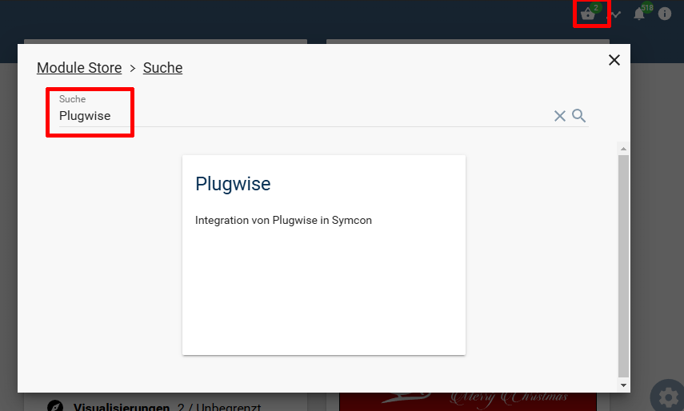

  

   

# Symcon-Modul: Plugwise <!-- omit in toc -->

Implementierung von Plugwise in IP-Symcon.

## Inhaltsverzeichnis  <!-- omit in toc -->

- [1. Funktionsumfang](#1-funktionsumfang)
  - [Plugwise Konfigurator:](#plugwise-konfigurator)
  - [Plugwise Network:](#plugwise-network)
  - [Plugwise Device:](#plugwise-device)
- [2. Voraussetzungen](#2-voraussetzungen)
- [3. Software-Installation](#3-software-installation)
- [4. Vorbereitungen](#4-vorbereitungen)
- [5. Einrichten der Instanzen in Symcon](#5-einrichten-der-instanzen-in-symcon)
- [6. Anhang](#6-anhang)
  - [1. GUID der Module](#1-guid-der-module)
  - [2. Datenaustausch](#2-datenaustausch)
  - [3. Changelog](#3-changelog)
  - [4. Spenden](#4-spenden)
- [6. Lizenz](#6-lizenz)

## 1. Funktionsumfang

### [Plugwise Konfigurator:](PlugwiseConfigurator/)  

- Darstellen alle in Symcon und den Plugwise-Netzwerk  bekannten Geräte und Instanzen.  
- Einfaches Anlagen von Instanzen in Symcon.  

### [Plugwise Network:](PlugwiseNetwork/)  

- Kommunikation mit dem USB-Stick.  
- An- und ab lernen von Geräten im Plugwise-Netzwerk.  

### [Plugwise Device:](PlugwiseDevice/)  

- Darstellen der Messwerte in Variablen.  
- Darstellen und ansteuern des Schaltzustandes.  

## 2. Voraussetzungen

- Symcon ab Version 8.1  
- Plugwise USB-Stick inklusive Circle+  
- Weitere Plugwise-Geräte wie Circle, Stealth oder Sens  

## 3. Software-Installation

Über den 'Module-Store' in Symcon das Modul 'Plugwise' hinzufügen.  
**Bei kommerzieller Nutzung (z.B. als Errichter oder Integrator) wenden Sie sich bitte an den Autor.**  
  

## 4. Vorbereitungen

- Der USB-Stick und der Circle+ müssen gekoppelt sein  
- Die Plugwise Software darf nicht gleichzeitig ausgeführt werden

## 5. Einrichten der Instanzen in Symcon

Nach der Installation über den 'Modul-Store' fragt Symcon ob die enthaltende [Konfiguratoren Instanz](PlugwiseConfigurator/) erstellt werden soll.  
Das Anlegen der erforderlichen Instanzen wird in der Dokumentation des [Plugwise-Konfigurator](PlugwiseConfigurator/) beschrieben.  

## 6. Anhang

### 1. GUID der Module

|         Modul         |     Typ      |  Prefix  |                  GUID                  |
| :-------------------: | :----------: | :------: | :------------------------------------: |
|    Plugwise Device    |    Device    | PLUGWISE | {5FD73328-68F3-4047-B678-E385C2E31962} |
| Plugwise Configurator | Configurator | PLUGWISE | {4C481455-ACE8-45FF-9C5E-02C8F70CEBC7} |
|   Plugwise Network    |   Splitter   | PLUGWISE | {7C20491F-F145-4F1C-A69C-AAE1F60F5BD5} |

### 2. Datenaustausch

| Parameter |  Typ   |                 Beschreibung                  |
| :-------: | :----: | :-------------------------------------------: |
|  Command  | string |                Command 4 Byte                 |
|  NodeMAC  | string |       Quell/Ziel MAC des Node oder leer       |
|   Data    | string | Payload  ohne NodeMac, Command und Checksumme |

### 3. Changelog

**Version 2.00:**  

- Kommunikation mit dem Stick verbessert  
- Statusabfrage der Nodes erfolgt erst nachdem die Netzwerksuche abgeschlossen wurde  
- Debug Ausgaben angepasst, um bei Fehlern besser analysieren zu können  
- Berechnung von Energy Variablen angepasst  
- Konfigurationsformulare überarbeitet  
- Variablenhandling angepasst  
- Umstellung von Profile auf Darstellungen  
- Statusvariable für Erreichbar ergänzt  
- Übersetzungen ergänzt  
- Dokumentation überarbeitet  
  
**Version 1.10:**  

- Beta Version zur Vorbereitung des Refactoring  
- Diverse kleine Bugfixes  
  
**Version 1.00:**  

- Release

**Version 0.98:**  

- Fixes für Symcon 5.0  

**Version 0.96:**  

- Erstes offizielles Release  

### 4. Spenden  
  
Die Library ist für die nicht kommerzielle Nutzung kostenlos, Schenkungen als Unterstützung für den Autor werden hier akzeptiert:  

PayPal:  
  

Wunschliste:  
  

## 6. Lizenz

IPS-Modul:  
[CC BY-NC-SA 4.0](https://creativecommons.org/licenses/by-nc-sa/4.0/)  
